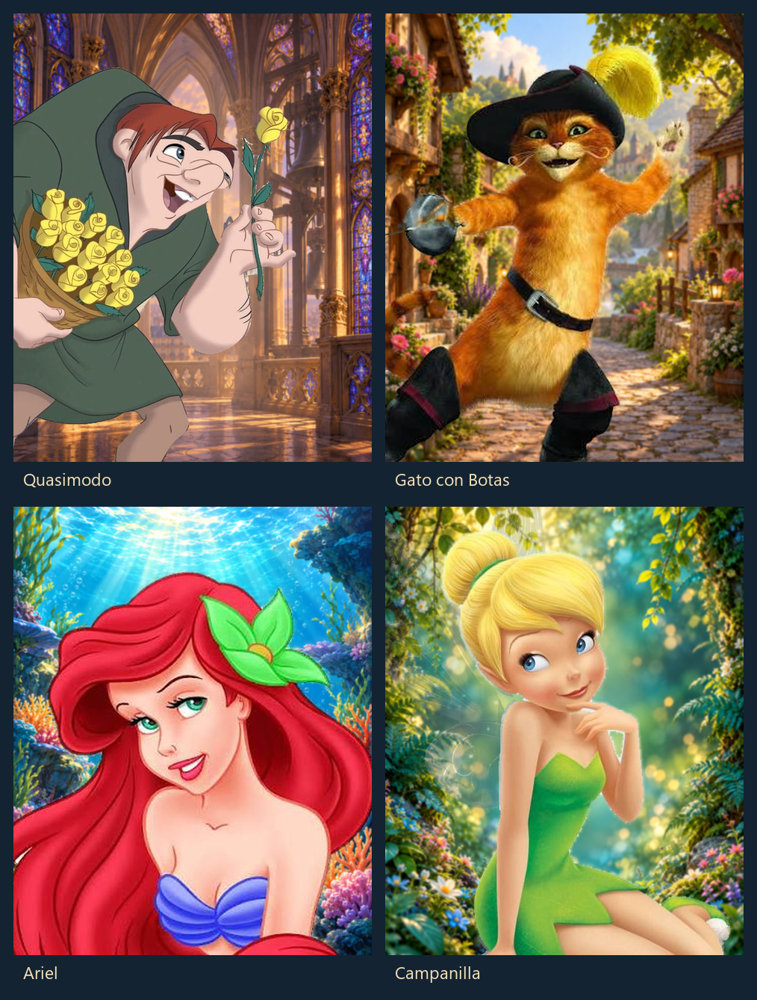

# Auditoría y retratos publicados

Se revisaron los 200 libros vigentes y sus 697 personajes. La selección incluye 40 cuentos y aventuras clásicas, con 147 personajes. Tener foto previa no excluye del reemplazo.

Quedaron publicados **40 retratos: 38 reemplazos y 2 imágenes nuevas**. La auditoría identifica además 8 reemplazos que no pudieron generarse y 99 personajes todavía sin retrato.



Los cuatro personajes de la imagen se conservaron de los archivos proporcionados por el usuario y se montaron con Python sobre fondos nuevos. Los demás retratos y los fondos se crearon con la herramienta integrada de imágenes.

## Contenido

- [Informe completo](INFORME.md) y [auditoría navegable](auditoria.html), con consulta por libro y personaje.
- [Decisiones y estado de cada personaje](auditoria-completa.json).
- [Manifiesto de importación](manifest.json), con los UUID exactos de personaje, edición y libro.
- [Prompts, procedencia y hashes](prompts-y-procedencia.json).
- [Comprobación posterior en la base](verificacion-publicacion.json): 40 enlaces correctos y otros 657 personajes sin cambios.
- `images/`: 40 WebP, copiados byte a byte de los archivos publicados. Sus versiones originales de alta resolución permanecen locales.

La vista navegable usa las imágenes versionadas para los retratos publicados y conserva enlaces públicos para comparar con los anteriores.

## Validar una restauración

Desde `respaldos-software/LiteratusNovelist-main/Producto/backend`, con las dependencias y la configuración habituales:

```powershell
.\.venv\Scripts\python.exe manage.py import_portraits ../../../../docs/retratos/2026-10-28/manifest.json --images-root ../../../../docs/retratos/2026-10-28 --dry-run --replace
```

El comando solo valida. Para una publicación o restauración, seguir el [flujo de importación verificado](../../../respaldos-software/LiteratusNovelist-main/Producto/backend/docs/portraits.md): comprueba la huella de la base y exige `--apply`, `--upload` y la decisión explícita de reemplazo. Este paquete documenta una publicación ya aplicada en Supabase; el commit no vuelve a ejecutarla.

Los archivos no incluyen datos de inventario, sesiones de lectura, prompts de sistema, diálogos privados ni credenciales. Los respaldos y artefactos intermedios se mantienen fuera del repositorio.
